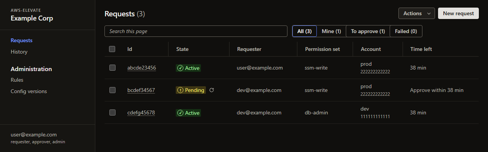
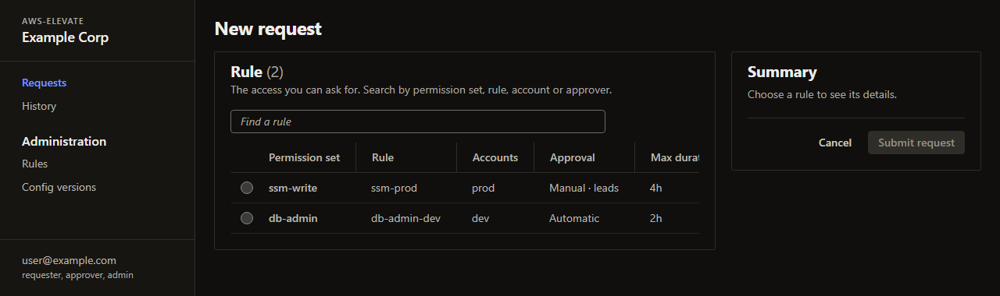
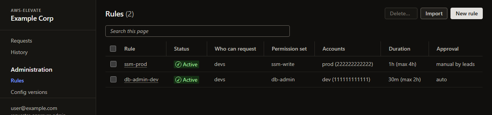

<h1 align="center">aws-elevate</h1>

<p align="center">
  <strong>Just-in-time elevated access for AWS IAM Identity Center.</strong><br>
  Ask for a permission set, for a limited time, with a reason. It is removed when the time is over.
</p>

<p align="center">
  <a href="https://github.com/sdiaco/aws-elevate/releases/latest"></a>
  <a href="https://github.com/sdiaco/aws-elevate/actions/workflows/check.yml"></a>
  <a href="LICENSE"></a>
  
</p>

<p align="center">
  Helps implement privileged-access controls for <strong>NIS2</strong>, <strong>DORA</strong> and <strong>GDPR</strong> · <a href="docs/security.md">Security and compliance</a>
</p>

---

## How it works

1. A user asks for a permission set on an account, for a few hours, with a reason.
2. A rule decides: the access is granted at once, or after someone of the approver group says yes.
3. Elevate creates a temporary permission set and assigns it. The user works with it from the console or the CLI.
4. When the time is over, or when someone revokes it, the access is denied and removed.

Everything runs in your AWS organization. Every request is kept in a history you can read and export.

<p align="center"></p>

---

## Before you start

You need:

- **AWS IAM Identity Center**, with the accounts of your organization assigned through it.
- The **delegated administrator account** of Identity Center. Elevate is installed there, in the Identity Center home region.
- **[AWS CLI v2](https://docs.aws.amazon.com/cli/latest/userguide/getting-started-install.html)** on Linux or macOS.
- **Three groups** in Identity Center (Identity Center console → **Groups**). Create them first, with any name:

| Group | Who is in it | What they can do |
|---|---|---|
| **Admins** | the people who run Elevate | install it, write the rules, revoke any access |
| **Requesters** | everyone who uses Elevate | ask for access |
| **Auditors** (optional) | security, compliance | read and export everything, change nothing |

---

## Install

You do this once, as an administrator. Three steps.

### 1. Install the client

```bash
curl -fsSL https://raw.githubusercontent.com/sdiaco/aws-elevate/main/install.sh | sh
aws-elevate --version
```

The script checks the SHA-256 of the download and installs `aws-elevate` in `~/.local/bin`.

### 2. Create a profile for the delegated administrator account

```bash
aws configure sso
```

Choose the delegated administrator account, an administrator role, and any profile name, for example `elevate-admin`.

### 3. Install Elevate

```bash
aws-elevate install --profile elevate-admin
```

The command asks for the region, the three groups (by name), an e-mail for alerts and, optionally, the name of your organization. It shows a summary, asks you to confirm, creates the stack in about 3 minutes and configures your client.

Then **confirm the e-mail subscription** you receive, so alerts reach you.

That is all: go to [First use](#first-use).

<details>
<summary><strong>Prefer the CloudFormation console? Use Launch Stack instead of step 3</strong></summary>

<br>

Sign in to the delegated administrator account and open the link of your Identity Center home region:

| Region | |
|---|---|
| Europe (Ireland) `eu-west-1` | [Launch Stack](https://eu-west-1.console.aws.amazon.com/cloudformation/home?region=eu-west-1#/stacks/create/review?templateURL=https://aws-elevate-releases-eu-west-1.s3.eu-west-1.amazonaws.com/v0.0.4/elevate.yaml&stackName=elevate) |
| US East (N. Virginia) `us-east-1` | [Launch Stack](https://us-east-1.console.aws.amazon.com/cloudformation/home?region=us-east-1#/stacks/create/review?templateURL=https://aws-elevate-releases-us-east-1.s3.us-east-1.amazonaws.com/v0.0.4/elevate.yaml&stackName=elevate) |

Fill in the first two groups of parameters and leave the rest as they are:

| Parameter | Value |
|---|---|
| **Admin group id** | id of the admin group |
| **Requester group id** | id of the requester group |
| **Auditor group id** | id of the auditor group, or empty |
| **Alert e-mail** | address for critical alerts |
| **Organization name** | shown at the top of the interface, optional |

The console needs the group **ids**, not the names: you find them in Identity Center → **Groups** → the group → **Group ID**.

Tick the IAM acknowledgement, create the stack, then configure the client:

```bash
aws-elevate setup --profile elevate-admin
```

</details>

Advanced settings (history retention, point-in-time recovery, your own KMS key, limits, events) are all optional: see [Installation details](docs/installation.md).

---

## First use

```bash
aws elevate ui
```

The interface opens in your browser. It runs on your computer and stops after 30 minutes without use.

1. **Write the first rule** (admins). Who may ask, which permission set, on which accounts, for how long, and whether it needs approval. After you publish, it takes about 30 seconds to apply.
2. **Ask for access.** Pick the role, the duration and write a reason. Do not put personal data in the reason: everyone who reads the history sees it.
3. **Use it.** When the access is ready, open it in the console or use the profile that Elevate writes for you:

   ```bash
   aws s3 ls --profile jit-<permission set>-<account id>
   ```

4. **Close it** when you are done, with **Revoke**. Otherwise it ends by itself.

<details>
<summary><strong>Screenshots</strong>: new request, rules</summary>

<br>





</details>

Everything also works from the terminal: `aws elevate request`, `status`, `approve`, `revoke`, `shell`. See `aws-elevate --help`.

---

## Add users

Each user installs the client and connects it, once:

```bash
curl -fsSL https://raw.githubusercontent.com/sdiaco/aws-elevate/main/install.sh | sh
aws configure sso          # any account of your Identity Center
aws-elevate setup --profile <name>
aws elevate ui
```

No admin step is needed: being in the requester group (or admin, or auditor) is enough. `setup` finds Elevate by itself.

---

## Uninstall

```bash
aws-elevate uninstall
```

It asks what to remove:

- **infra**: Elevate from AWS, for the whole organization. **Admins only.** It stops while any access is open, lets you export the history first, and asks you to type the stack name to confirm.
- **client**: `aws-elevate` from this computer. Every user does it on their own computer.

Details in [Installation details](docs/installation.md#uninstall).

---

## Security and compliance

- **No standing privileges.** Access exists only for the time asked, with a reason, and is denied at the expiry even before it is removed.
- **Separation of duties.** The part of Elevate that reads requests cannot grant access; the part that grants access never reads requests.
- **Everything is recorded.** Who asked, what, why, who approved, when it started and ended. Kept 13 months by default, up to 120.
- **Your data stays in your account.** Nothing leaves your AWS organization.
- **Optional hardening:** your own KMS key, point-in-time recovery, service control policies that keep even other admins away from the history.

Elevate helps implement privileged-access controls required by NIS2, DORA and GDPR; it does not by itself make an organization compliant. Read [Security and compliance](docs/security.md) for what is stored, for how long, and how it is protected.

---

## Costs

Pay per use, no fixed fee: an installation without requests costs about nothing. Each request adds a few calls to Lambda, DynamoDB, Step Functions and EventBridge. Optional extras: point-in-time recovery (a few cents for this table) and a customer KMS key (about $1 per month). `aws-elevate install` shows the idle cost before you confirm.

---

## Development

Everything runs in a container: only Docker is needed.

```bash
make dev        # shell with Go, Python, uv and the AWS CLI
make check      # lint and tests, as run before every push
```

How to contribute: [Contributing](docs/contributing.md).

## License

[Apache-2.0](LICENSE)
